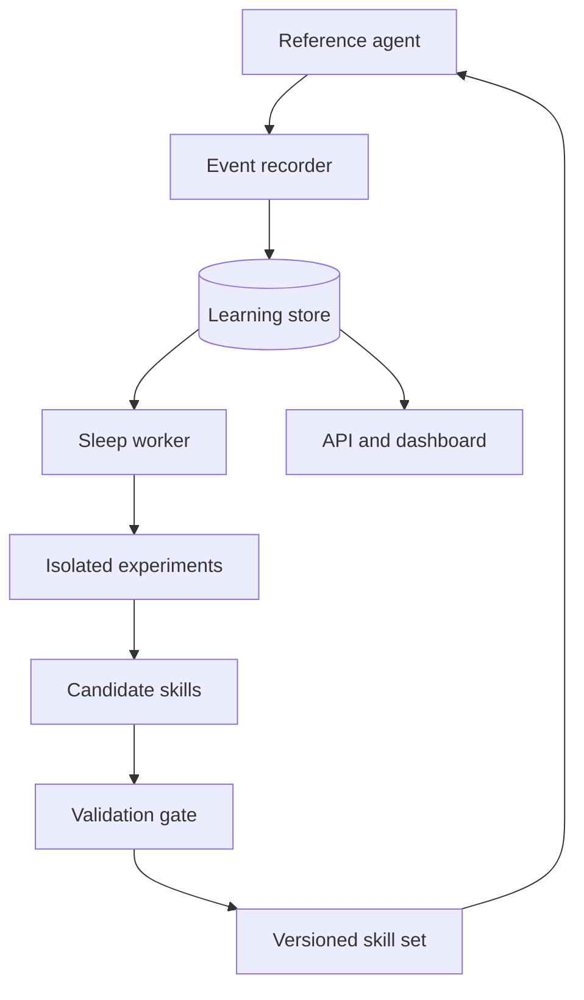

# Somnia — system architecture
Version 0.1 · Proposed v0.1 design within the accepted stack

## Design
A local modular Python application, one durable database and an artifact directory are sufficient for the first experiment. Use clear internal interfaces; do not turn every component into a service. The API and dashboard are clients of the same domain layer.

This diagram covers the learning loop. The sealed final evaluator is outside it; it reads frozen skill sets and does not feed task details back into the loop.

## Components and boundaries
| Component | Responsibility | Forbidden access |
|---|---|---|
| Agent runner | Fixed tools, prompts, step limits; produces solution artifacts | Other conditions' memory; hidden test oracle |
| Event recorder | Ordered, append-only events and hashes | Credentials in traces |
| Memory service | Typed memories, retrieval, provenance, skill-set versions | Sealed evaluation data |
| Sleep worker | Consolidate, select hypotheses, rehearse, propose skills | Final evaluation filesystem/database |
| Sandbox supervisor | Create fresh environments, apply quotas, collect artifacts | Provider secrets inside task containers |
| Gate runner | Execute validation and regression checks on frozen candidates | Modifying a candidate during scoring |
| Budget gateway | Reserve worst-case call cost, reconcile actual usage | Unmetered provider bypass |
| Final evaluator | Run frozen conditions on sealed tasks, write result artifacts | Mutating learning memory during evaluation |
| API | Authenticated commands, persisted status, evidence queries | Direct arbitrary shell access |
| Dashboard | Render real records and transparent simulated fixtures | Inventing measurements or approving skills through hover |

Use separate processes and database credentials for learning and evaluation. A separate schema alone is insufficient if the learner's role can access it. Final tasks/oracles live in a separately permissioned evaluation location, absent from the learner's worktree and container mounts.

## Logical data model
All records carry a schema version, stable ID, creation timestamp and project scope. UUIDs are a proposed ID format. These are conceptual tables, not migrations already written.

| Table/group | Essential fields or relationships |
|---|---|
| projects, sessions | project ID; session identity; agent/config hashes; lifecycle |
| events | session ID; monotonic sequence; event type; payload/ref; redaction status; hash |
| artifacts | SHA-256; relative storage URI; media type; byte size; sensitivity |
| memory_items, memory_versions | type; immutable body version; sources; validity; applicability; supersedes |
| embeddings | memory-version ID; provider/model/revision; dimension; normalized flag; vector |
| sleep_runs, stage_attempts | input snapshot; configuration hash; stage; lease; retry; output refs; budget ID |
| hypotheses, scenarios | source refs; claim; intervention; expected observation; oracle/ref implementation hashes |
| experiment_runs | scenario ID; image digest; attempt; solution hash; outcome; resource use; diagnostics |
| skills, skill_versions | immutable text; scope; exclusions; evidence IDs; lifecycle |
| gate_decisions | candidate hash; validator/version; suite hash; paired scores; decision; reason |
| skill_sets, skill_set_members | immutable membership; predecessor; activation pointer |
| provider_calls, reservations | request ID; model; price snapshot; token limits; actual usage; accounting state |
| audit_events | actor; action; target versions; reason; correlation ID |

Use foreign keys and uniqueness constraints for evidence links, per-session sequence, run-stage idempotency keys and skill-set membership. Important filter/identity fields are typed columns; variable tool payloads use JSONB. Link large logs and filesystem artifacts by hash instead of putting every byte in rows.

Memory retirement and activation are explicit application transactions. Database storage does not supply knowledge versioning automatically. Final-evaluation results use an independently controlled store; publish selected reports after freezing research decisions.

## Job semantics
A PostgreSQL-backed job table is the initial durable queue. One worker is enough. Claim a job using a transaction and an expiring lease; record attempts and a heartbeat. This is at-least-once processing with idempotent writes, not exactly-once execution.

Commit stage outputs before moving the stage pointer. A crashed stage resumes from verified outputs when possible. External model calls may have completed before a crash; a call with uncertain billing remains reserved and must be reconciled before automatic replay.

Promotion uses a transaction: check immutable candidate and gate hashes, check expected active skill-set version, insert the new set, update the active pointer, append audit event. A competing change forces revalidation or a recorded retry; never silently overwrite it.

## Internal contracts
| Contract | Minimum request | Minimum response |
|---|---|---|
| Record event | project/session, sequence, type, payload/ref, idempotency key | event ID and hash |
| Retrieve context | project, task query, scope, skill-set ID, token ceiling | selected versions, source refs, exclusion reasons, token count |
| Start sleep | input snapshot ID, config hash, budget ID | run ID and persisted state |
| Execute scenario | immutable scenario, image digest, quotas | status, solution/artifact refs, oracle results, runtime |
| Validate candidate | candidate version, baseline set, validation-suite ID | decision and evidence refs |
| Activate set | gate decision, expected previous set, actor | new set ID and audit ID |
| Report run | run ID | stages, outcomes, usage, evidence links, unresolved states |

Internal interfaces should be typed and versioned. The proposed external API uses POST /v1/sleep-runs, GET /v1/sleep-runs/{id}, GET /v1/sleep-runs/{id}/events, GET /v1/skills/{id}/versions and POST /v1/skill-sets/activate. Mutations require idempotency keys. Use polling first; SSE is optional after persisted event ordering works. MCP tools should later wrap these capabilities with explicit permissions.

## Execution boundary
Before running generated code: non-root user; no privileged mode; no Docker socket; no host home/workspace mounts; read-only image with a bounded writable task directory; disabled external network; CPU, memory, process, disk-output and time limits; controlled dependencies from a prebuilt image.

Model requests originate from the trusted host gateway. Containers receive task data and permitted local tools, not API keys. The final oracle must not be visible in the target agent's accessible filesystem; run hidden tests in a separate scoring step/environment against the submitted artifact.

Docker is not a proof of strong isolation. Scope v0.1 to controlled local tasks; evaluate VM isolation before hostile third-party workloads. Verify containment rather than trusting model instructions.

## Reproducibility and persistence
Record code commit, dirty-tree status, dependency lock hash, image digest, prompt/template versions, exact model identifier, provider request ID, decoding settings, seed if supported, input snapshot, retrieved versions, full bounded tool observations, scorer versions, timings and costs.

Provider nondeterminism or aliases can prevent bitwise reproduction. Mark this limitation; do not silently switch models during a study. Back up database and referenced artifacts together, verify restoration before a final study, and record artifact hashes in a run manifest.

Suggested future layout: src/somnia/{agent,memory,sleep,storage,budget,api}, evals/{harness,development,validation}, tests, dashboard, docs if later moved deliberately. Sealed tasks must remain outside the learner checkout. Use JSON/Markdown exports for portability, not a second primary database.
