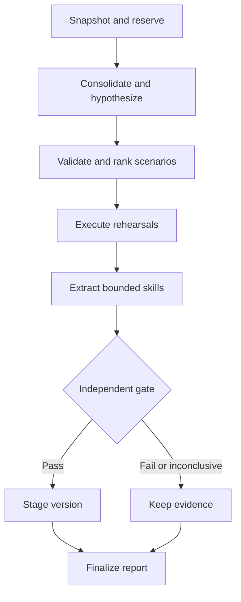

# Somnia — offline learning engine
Version 0.1 · Proposed algorithm; no implementation or results yet

## Inputs and outputs
Inputs: immutable episode snapshot, current skill-set version, frozen optimizer/target model configurations, allowed experiment families, validator version and spending envelope.

Outputs: run manifest; analyzed evidence; valid/invalid scenarios; attempts and observations; proposed skills; gate decisions; staged skill-set version if applicable; cost and failure report.

An empty proposal set is a legitimate result.

## Durable state machine

Every stage records attempt ID, inputs and hashes, lease, outputs, usage and termination reason. Cancellation and budget exhaustion checkpoint completed work and end the run without inventing validation results.

## 1. Snapshot
Freeze episode IDs and hashes, active skills, retrieval configuration, model/optimizer versions, oracle contracts and total budget. New live sessions are queued for a later run. Validate that the input contains no final-evaluation identifiers.

## 2. Consolidate and hypothesize
Find repeated failures, near misses, contradictions and fragile assumptions. A hypothesis states a causal mechanism and a falsifiable observation. “The agent should be better at concurrency” is insufficient.

Example: “Saving the checkpoint before saving the output allows a restart to omit data.” Record the episode evidence, predicted fault boundary and what would falsify the hypothesis.

Proposed limits: up to four hypotheses and two proposed scenarios per hypothesis per cycle. Limit output lengths at the gateway. These are defaults to calibrate on development data.

## 3. Generate and validate scenarios
A scenario specifies task instructions, environment fixture, intervention, expected invariant, reference implementation, deliberately faulty implementation and objective oracle.

A scenario is eligible only if the reference passes, at least one relevant known fault is detected, the intervention is reachable, dependencies are available and repetitions are stable. Validate task ambiguity and scope, not just syntactic execution.

Generated task descriptions and generated tests can share the same mistaken assumption. Use a fixed reviewed oracle contract and independent review/mutation checks. Mark invalid or inconclusive scenarios and count their full cost; never convert them to successful failure discoveries.

## 4. Select experiments
Proposed first selector: normalized relevance × suspected impact × uncertainty × testability, divided by conservative estimated execution cost. Each factor is ordinal (0, 0.5, 1), assigned from explicit rules and logged; the result is a heuristic, not a calibrated value-of-information estimate.

Reserve a small fixed exploration fraction (one in four selections where enough candidates exist) for random eligible scenarios. Tie-breaking uses a logged seed. Compare against uniform selection from the identical candidate pool in an exploratory ablation. If candidate counts are too small, report that H3 was not meaningfully tested.

Start with up to four executed scenarios per cycle and at most two target attempts each. All calls, including generation and judging, consume the same run allowance. Do not automatically scale counts because a task is difficult.

## 5. Execute
Create a fresh task environment for each attempt. Freeze the target agent and current skill set; retain its solution, trace and test outputs. A fault injection is a controlled local fixture, not a real service attack.

Classify task failure, invalid scenario, agent timeout, infrastructure failure and safety violation separately. No reward is based solely on the optimizer's opinion.

## 6. Extract candidate skills
Propose at most two compact skills per cycle. Each must specify procedure, scope, exclusions, evidence and known limits. Generalize beyond file names and exact answers. Exclude hidden test content, final-task hints, secrets and executable side effects.

The default candidate is declarative text. Any future executable skill needs a separate code-review and sandbox policy.

## 7. Independent gate
Freeze the candidate hash, then run paired with/without tests on independently authored validation tasks, plus a retention panel and incompatible-applicability cases. The optimizer may receive a bounded decision/reason; do not expose hidden oracle implementation.

Proposed pilot rule: at least one paired task improvement, no observed paired regressions on the prespecified retention panel, no forbidden-action violations, and no scope misuse on exclusion cases. Require the configured repetitions to agree; otherwise return inconclusive. These small-sample engineering gates do not establish a population regression rate or scientific significance.

Cap candidate attempts and validation queries (initially two candidates per cycle; no more than two cycles before reviewing the protocol). Log all rejected candidates. Repeated gate reuse can overfit, so rotate reserved validation panels or stop and design a new development round. The final test remains separate.

## 8. Stage, activate and report
Write immutable skill and gate records before creating a proposed skill set. Automatic activation is allowed only inside the controlled experimental condition under its frozen protocol. Do not write into a developer's real agent memory files by default.

Each report states: attempted hypotheses; invalid scenarios; executed attempts; genuine discovered faults; candidates accepted/rejected/inconclusive; total usage; interrupted work; active set before/after; limitations. A staged skill must link back to the original evidence.

## Recovery and stopping
Resume completed stages by matching hashes. Promotion is idempotent. Retries are bounded and budgeted; an unknown provider charge remains reserved. Stop on budget uncertainty, resource policy violation, invalid oracle assumptions, inaccessible required evidence or stale parent skill-set version.

A “sleep complete” status means the workflow finalized. It never means “learning succeeded” unless a separate evaluation supports that claim.
