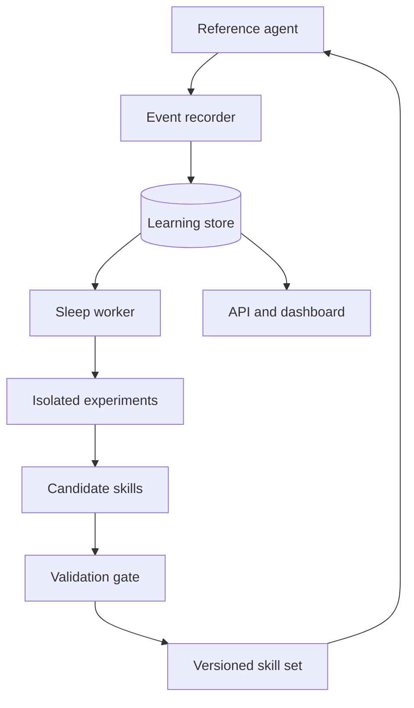
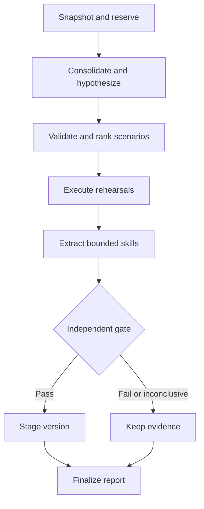

# Somnia — Project Knowledge

Version 0.1 · 18 November 2026

Combined reading copy of the individual project specifications. Use PROJECT_CONTEXT.md for a quick handoff and CHATGPT_PROJECT_INSTRUCTIONS.md for project behavior. Individual source files are authoritative for edits. No implementation or experiments have been completed.

## Contents

1. README.md
2. PROJECT.md
3. RESEARCH.md
4. ARCHITECTURE.md
5. MEMORY.md
6. SLEEP_ENGINE.md
7. EXPERIMENTS.md
8. BUDGET.md
9. DASHBOARD.md
10. ROADMAP.md
11. AGENTS.md
12. HANDOFFS.md
13. DECISIONS.md
14. RESEARCH_JOURNAL.md
15. STATUS.md

---

Source: README.md

## Somnia — project documentation
Version 0.1 · 18 November 2026 · Documentation baseline; implementation not started.

Somnia investigates whether an agent can use downtime to discover weaknesses, run controlled experiments, and retain skills that improve later work. The base model stays frozen. Improvement must be demonstrated on tasks the learning system has never seen.

### Start here
1. Read [PROJECT_CONTEXT.md](PROJECT_CONTEXT.md) for the compact, authoritative handoff.
2. Read [PROJECT.md](PROJECT.md) for scope and [EXPERIMENTS.md](EXPERIMENTS.md) for what would count as evidence.
3. Use [AGENTS.md](AGENTS.md) and [HANDOFFS.md](HANDOFFS.md) when assigning engineering work.
4. Check [STATUS.md](STATUS.md) before acting. A plan is not a completed implementation.

### Document map
| File | Owns |
|---|---|
| PROJECT.md | Mission, boundaries, acceptance criteria, responsibilities |
| RESEARCH.md | Source-backed prior art, hypotheses, novelty audit |
| ARCHITECTURE.md | Components, data model, contracts, security boundaries |
| MEMORY.md | Memory semantics, retrieval, revision and retirement |
| SLEEP_ENGINE.md | Resumable offline learning procedure |
| EXPERIMENTS.md | Splits, baselines, scoring, statistical analysis |
| BUDGET.md | CAD 50 ceiling, reservations, spending and model selection |
| DASHBOARD.md | Interface brief and truthful visual behavior |
| ROADMAP.md | Fourteen working-day sprint and milestone gates |
| AGENTS.md | Instructions for engineering agents |
| HANDOFFS.md | Ready-to-use scoped assignments |
| DECISIONS.md | Accepted decisions, proposals and superseded advice |
| RESEARCH_JOURNAL.md | Dated evidence and experiment entries |
| STATUS.md | Current state, blockers and next action |
| PROJECT_CONTEXT.md | Compact context for a fresh conversation |
| CHATGPT_PROJECT_INSTRUCTIONS.md | Text for the Project instructions field |

### Set up the ChatGPT Project
Copy the text in CHATGPT_PROJECT_INSTRUCTIONS.md into the Project instructions field. Add PROJECT_CONTEXT.md and SOMNIA_PROJECT_KNOWLEDGE.md as knowledge files. The latter is a generated reading copy of the specifications, including this index. Do not upload the ZIP as a substitute for readable knowledge files.

The ZIP contains the individual Markdown sources for the future repository, plus the instructions and compact context. Extract it, preserving filenames. The repository root is the intended home for these files; no repository has been created or modified by this documentation task.

The individual documents are the editing source of truth. Regenerate the combined reading copy after changes; do not edit both independently. Replace outdated Project attachments when publishing a new documentation version. ChatGPT context is not a guaranteed substitute for maintained files.

### Status and authority
“Accepted” records an explicit user decision or an already accepted direction. “Proposed v0.1” is a concrete engineering or research default, ready for review and implementation, not an assertion that the user separately approved every detail. “Verified” means checked against the cited primary material, not reproduced experimentally. “Unverified” means an open question.

Latest explicit user decisions supersede these files. Otherwise use DECISIONS.md for decisions, STATUS.md for progress, EXPERIMENTS.md for evaluation rules, and the specialist document for its domain. Resolve contradictions explicitly and update affected files. All timestamps are UTC unless labeled; planning dates use America/Toronto.

---

Source: PROJECT.md

## Somnia — master specification
Version 0.1 · 18 November 2026

### Mission
Build a model-independent offline learning system that turns an agent's recorded experience into evidence-backed, reusable knowledge. Its scientific purpose is to test whether deliberately selected executable rehearsals improve future task performance beyond strong memory and skill-learning baselines at comparable cost.

“Sleep” is a scheduling and consolidation metaphor. Somnia does not claim consciousness, literal biological sleep, automatic weight learning, or general self-improvement.

### Confirmed direction
| Decision | Status |
|---|---|
| Name: Somnia | Accepted; supersedes REVEIL/Reveil and earlier working names |
| Serious long-term research, with an initial 14-day sprint | Accepted; results are not guaranteed |
| PostgreSQL + pgvector from day one | Accepted; no SQLite-to-Postgres detour |
| Custom memory and learning layer | Accepted |
| Claude Code leads engine/backend implementation | Accepted |
| Codex owns independent evaluation and engineering/security review | Accepted |
| Claude models build frontend | Accepted; no named model mandated |
| No Higgsfield for now | Accepted |
| Additional experimental model spending: at most CAD 50 | Recorded ceiling; currency inherited conservatively from agreed plan |
| Local infrastructure, private repository initially | Accepted direction; neither provisioned yet |

### First demonstrable capability
A controlled coding agent completes a task, leaves a replayable record, and later enters one bounded sleep run. Somnia identifies a weakness, creates a valid experiment, executes it in an isolated environment, proposes an applicability-scoped skill, and either stages it after an independent gate or rejects it with evidence. A new agent session retrieves a fixed, versioned skill set. A separate evaluator tests whether that set helps on untouched tasks.

A run with no accepted skill is valid. “The pipeline ran” and “the agent improved” are different outcomes.

### Concrete example: interrupted research indexing
An agent implements a local indexer for a research notebook. The task looks successful on small files. Its trace suggests the indexer advances a progress checkpoint before writing results.

During sleep, Somnia asks: “Could a crash between these operations silently lose indexed content?” A fixture injects a failure at that boundary, restarts the indexer, and checks that the final index contains each intended record exactly once. It also checks a known-correct reference implementation and an intentionally faulty one.

A proposed lesson might be: “For resumable work, make completed output durable before advancing progress; make a repeated attempt safe.” Its scope must distinguish a local transaction from an external side effect that cannot be rolled back. It must not prescribe a single global lock for every concurrent program.

An independent gate tests the lesson on different implementations and incompatible cases. The sealed final suite uses new tasks and hidden checks. This is an illustrative mechanism, not a completed experiment or a benchmark item to reuse in the final test.

### v0.1 scope
Required: a controlled reference agent; frozen task manifests; durable PostgreSQL records; episodic evidence; versioned procedural skills; bounded retrieval; executable rehearsals; deterministic correctness checks; independent promotion validation; conservative cost accounting; resumable jobs; immutable reports and rollback.

First task domain: local Python reliability/state-management problems with controlled fault injection. Introduce concurrency only where scheduling can be made reproducible. Initial families and counts are proposals in EXPERIMENTS.md.

A minimal dashboard may display completed runs and provenance once contracts are stable. The research workflow must work from a CLI/report without the dashboard.

Deferred: weight updates; unrestricted autonomous agents; browser/web tasks; a general-purpose task marketplace; a hosted multi-user product; a dedicated graph database; broad native agent integrations; production scheduling; large cinematic assets; an elaborate 3D brain before the end-to-end loop works.

### Architecture commitments
Python engine and state machine; PostgreSQL/pgvector; FastAPI at the service boundary; Docker-based restricted execution; Inspect AI plus pytest for evaluation; NumPy/SciPy for analysis; Next.js/TypeScript with Three.js/React Three Fiber for the intended frontend. SDK/MCP are integration targets after the controlled reference agent.

Voyage AI is the initial embedding direction, conditional on verified access, cost and a pinned embedding specification. Provider adapters must allow a different embedding service without changing memory semantics. Do not silently mix embedding spaces. Exact dependency versions remain to be resolved against the development environment and locked before execution.

### Milestone acceptance
| Gate | Evidence required |
|---|---|
| Foundation | Frozen development manifests, documented task oracles, database migrations, bounded mock calls |
| First sleep cycle | A fully traceable candidate accepted or rejected, resume after interruption, no duplicate promotion |
| Scientific pilot | Matched baseline comparisons, valid paired records, cost and uncertainty report |
| v0.1 research prototype | Reproducible artifacts, sealed-test policy followed, limitations and negative findings documented |

The previous +5–10 percentage-point improvement, at least 90% context recall, at most 5% regressions and 100+ tasks are aspirations, not demonstrated facts or mandatory success claims. Budget and power determine study size. Recall is secondary and requires a separately specified ground truth.

### Responsibilities
The user is research lead and final decision-maker. This ChatGPT Project coordinates research, architecture, critique and continuity. Claude Code implements the learning method. Codex constructs and operates independent evaluations and reviews implementation. A dedicated Claude frontend session builds the interface. Development assistants are not automatically the experimental models.

Evaluation independence requires access restrictions and frozen artifacts, not just two model brands or two Git worktrees.

### Definition of completion for this task
A consistent documentation package and reusable Project context. No product code, external repository, paid experiment, model purchase or configured ChatGPT Project is implied by delivering these files.

---

Source: RESEARCH.md

## Somnia — research specification and evidence register
Version 0.1 · Primary-source review: 18 November 2026
Status: initial literature map, not an exhaustive novelty review or reproduction.

### Research question
Under a fixed offline spending envelope and an identical online agent harness, does selecting and executing counterfactual experiments produce more transferable procedural knowledge than strong experience-based skill optimization?

The contribution under investigation is a combination of experiment selection, executable evidence and applicability-aware learning. None is presumed novel on its own.

### Hypotheses
H1 (primary): Somnia improves macro-averaged task success on a sealed evaluation set relative to the strongest feasible, faithfully configured skill-learning comparator, with equal allowed offline budget and identical online limits.

H2 (secondary): Applicability conditions and an independent validation gate reduce harmful transfer under controlled environment changes, compared with a prespecified gate/scope ablation.

H3 (exploratory): A simple experiment-priority rule discovers more valid, actionable failures per CAD than random selection from the same candidate pool.

H1 can fail even if Somnia discovers more failures. H3 can succeed without helping later tasks. Report these separately. No weight update is part of these hypotheses.

### Primary sources checked
| ID | Source and link | Verified scope; implication |
|---|---|---|
| R1 | [Microsoft SkillOpt repository](https://github.com/microsoft/SkillOpt) | Text-space skill optimization for frozen agents; candidate primary comparator. Source reproduction and commit pinning remain undone. |
| R2 | [SkillOpt-Sleep documentation](https://microsoft.github.io/SkillOpt/docs/sleep/) | Offline session review, replay, consolidation, validation and staged adoption already exist. Optional variants and repeated rollouts are documented. Somnia cannot claim these general ideas as new. |
| R3 | [Anthropic: The components of agent memory](https://www.anthropic.com/research/components-of-agent-memory) | Published 6 November 2026. Discusses organizing memory through dreaming, correcting notes and creating representations. Establishes substantial overlap with consolidation. |
| R4 | [Letta: Sleep-time Compute](https://www.letta.com/blog/sleep-time-compute/) | Published 21 April 2025. Describes using idle computation to rewrite memory. A relevant foundation, not evidence of Somnia's effectiveness. |
| R5 | [Agentic Context Engineering, arXiv:2510.04618](https://arxiv.org/abs/2510.04618) | Describes evolving context playbooks through generation, reflection and curation. Evaluate as a context-learning comparator where feasible. |
| T1 | [PostgreSQL JSON types](https://www.postgresql.org/docs/current/datatype-json.html) | JSONB supports indexed structured-document storage alongside relational records. |
| T2 | [pgvector](https://github.com/pgvector/pgvector) | Supports exact vector search and approximate indexes; exact search is the initial research default. |
| T3 | [Inspect sandboxing](https://inspect.aisi.org.uk/sandboxing.html) | Documents sandbox abstractions for executing evaluation tools and code. Our isolation settings still need implementation and testing. |

These are living sources. Record exact commit IDs for code and a dated source snapshot or content hash when beginning a reproduction. Source pages establish documented capabilities, not measured parity under our harness. Competitor results must not be copied into Somnia's results.

### Corrections to earlier discussion
Do not assert that SkillOpt is purely prompt replay or incapable of environment execution. Backend capabilities vary and must be audited at a fixed commit. The earlier proposed fresh-worktree gap is unverified.

“ACE” is ambiguous. R5 is Agentic Context Engineering; it does not by itself substantiate the earlier assertion about a particular adversarial unit-test generation system. Resolve the exact paper before making that claim.

A database recommendation is an architectural judgment, not a universal ranking. Compatibility through a Python interface or MCP does not mean Somnia is already integrated into Claude/Codex or that every framework shares memory semantics.

No broad “first AI that sleeps,” “first validated skill learner,” or “big tech cannot do this” statement is defensible from this review.

### Prior-art audit before a novelty claim
For each candidate competitor, capture: title/authors, exact version, license, available code, training data access, optimizer/target models, environment execution, scenario generation, selection strategy, skill representation, validation protocol, total cost and integration limitations.

For SkillOpt, run its documented example at a pinned revision before adaptation; compare its published/default behavior to any adapted harness. Log each deviation. Inspect replay isolation, generated scenario handling, validation split usage, external tool support and cost coverage. Do not disable strong documented options simply to create an easy baseline.

Expand literature work to active failure discovery, adversarial test generation, curriculum/active learning, software repair, episodic replay, procedural memory and continual adaptation. Each proposed novelty needs a mechanism-level comparison and a direct primary source. Neuroscience can motivate a metaphor; it cannot validate an engineering mechanism.

### Candidate contribution statement
Proposed, not established: “Somnia studies budgeted selection of executable counterfactual rehearsals for frozen coding agents, with evidence-linked skills and applicability-aware validation.”

A credible first report can still be valuable if it finds that simpler replay performs equally well, or that selection overhead overwhelms its benefits. Bound the claim to the measured model, harness, task distribution and budget.

### Reproduction record template
Source ID; URL; retrieved date; commit/release; license; environment digest; installation notes; exact command; model IDs; dataset hashes; documented expected behavior; observed behavior; discrepancies; adaptation diff; cost; artifacts; conclusion.

No competitor implementation has been cloned, run, or reproduced during documentation preparation.

---

Source: ARCHITECTURE.md

## Somnia — system architecture
Version 0.1 · Proposed v0.1 design within the accepted stack

### Design
A local modular Python application, one durable database and an artifact directory are sufficient for the first experiment. Use clear internal interfaces; do not turn every component into a service. The API and dashboard are clients of the same domain layer.

This diagram covers the learning loop. The sealed final evaluator is outside it; it reads frozen skill sets and does not feed task details back into the loop.

### Components and boundaries
| Component | Responsibility | Forbidden access |
|---|---|---|
| Agent runner | Fixed tools, prompts, step limits; produces solution artifacts | Other conditions' memory; hidden test oracle |
| Event recorder | Ordered, append-only events and hashes | Credentials in traces |
| Memory service | Typed memories, retrieval, provenance, skill-set versions | Sealed evaluation data |
| Sleep worker | Consolidate, select hypotheses, rehearse, propose skills | Final evaluation filesystem/database |
| Sandbox supervisor | Create fresh environments, apply quotas, collect artifacts | Provider secrets inside task containers |
| Gate runner | Execute validation and regression checks on frozen candidates | Modifying a candidate during scoring |
| Budget gateway | Reserve worst-case call cost, reconcile actual usage | Unmetered provider bypass |
| Final evaluator | Run frozen conditions on sealed tasks, write result artifacts | Mutating learning memory during evaluation |
| API | Authenticated commands, persisted status, evidence queries | Direct arbitrary shell access |
| Dashboard | Render real records and transparent simulated fixtures | Inventing measurements or approving skills through hover |

Use separate processes and database credentials for learning and evaluation. A separate schema alone is insufficient if the learner's role can access it. Final tasks/oracles live in a separately permissioned evaluation location, absent from the learner's worktree and container mounts.

### Logical data model
All records carry a schema version, stable ID, creation timestamp and project scope. UUIDs are a proposed ID format. These are conceptual tables, not migrations already written.

| Table/group | Essential fields or relationships |
|---|---|
| projects, sessions | project ID; session identity; agent/config hashes; lifecycle |
| events | session ID; monotonic sequence; event type; payload/ref; redaction status; hash |
| artifacts | SHA-256; relative storage URI; media type; byte size; sensitivity |
| memory_items, memory_versions | type; immutable body version; sources; validity; applicability; supersedes |
| embeddings | memory-version ID; provider/model/revision; dimension; normalized flag; vector |
| sleep_runs, stage_attempts | input snapshot; configuration hash; stage; lease; retry; output refs; budget ID |
| hypotheses, scenarios | source refs; claim; intervention; expected observation; oracle/ref implementation hashes |
| experiment_runs | scenario ID; image digest; attempt; solution hash; outcome; resource use; diagnostics |
| skills, skill_versions | immutable text; scope; exclusions; evidence IDs; lifecycle |
| gate_decisions | candidate hash; validator/version; suite hash; paired scores; decision; reason |
| skill_sets, skill_set_members | immutable membership; predecessor; activation pointer |
| provider_calls, reservations | request ID; model; price snapshot; token limits; actual usage; accounting state |
| audit_events | actor; action; target versions; reason; correlation ID |

Use foreign keys and uniqueness constraints for evidence links, per-session sequence, run-stage idempotency keys and skill-set membership. Important filter/identity fields are typed columns; variable tool payloads use JSONB. Link large logs and filesystem artifacts by hash instead of putting every byte in rows.

Memory retirement and activation are explicit application transactions. Database storage does not supply knowledge versioning automatically. Final-evaluation results use an independently controlled store; publish selected reports after freezing research decisions.

### Job semantics
A PostgreSQL-backed job table is the initial durable queue. One worker is enough. Claim a job using a transaction and an expiring lease; record attempts and a heartbeat. This is at-least-once processing with idempotent writes, not exactly-once execution.

Commit stage outputs before moving the stage pointer. A crashed stage resumes from verified outputs when possible. External model calls may have completed before a crash; a call with uncertain billing remains reserved and must be reconciled before automatic replay.

Promotion uses a transaction: check immutable candidate and gate hashes, check expected active skill-set version, insert the new set, update the active pointer, append audit event. A competing change forces revalidation or a recorded retry; never silently overwrite it.

### Internal contracts
| Contract | Minimum request | Minimum response |
|---|---|---|
| Record event | project/session, sequence, type, payload/ref, idempotency key | event ID and hash |
| Retrieve context | project, task query, scope, skill-set ID, token ceiling | selected versions, source refs, exclusion reasons, token count |
| Start sleep | input snapshot ID, config hash, budget ID | run ID and persisted state |
| Execute scenario | immutable scenario, image digest, quotas | status, solution/artifact refs, oracle results, runtime |
| Validate candidate | candidate version, baseline set, validation-suite ID | decision and evidence refs |
| Activate set | gate decision, expected previous set, actor | new set ID and audit ID |
| Report run | run ID | stages, outcomes, usage, evidence links, unresolved states |

Internal interfaces should be typed and versioned. The proposed external API uses POST /v1/sleep-runs, GET /v1/sleep-runs/{id}, GET /v1/sleep-runs/{id}/events, GET /v1/skills/{id}/versions and POST /v1/skill-sets/activate. Mutations require idempotency keys. Use polling first; SSE is optional after persisted event ordering works. MCP tools should later wrap these capabilities with explicit permissions.

### Execution boundary
Before running generated code: non-root user; no privileged mode; no Docker socket; no host home/workspace mounts; read-only image with a bounded writable task directory; disabled external network; CPU, memory, process, disk-output and time limits; controlled dependencies from a prebuilt image.

Model requests originate from the trusted host gateway. Containers receive task data and permitted local tools, not API keys. The final oracle must not be visible in the target agent's accessible filesystem; run hidden tests in a separate scoring step/environment against the submitted artifact.

Docker is not a proof of strong isolation. Scope v0.1 to controlled local tasks; evaluate VM isolation before hostile third-party workloads. Verify containment rather than trusting model instructions.

### Reproducibility and persistence
Record code commit, dirty-tree status, dependency lock hash, image digest, prompt/template versions, exact model identifier, provider request ID, decoding settings, seed if supported, input snapshot, retrieved versions, full bounded tool observations, scorer versions, timings and costs.

Provider nondeterminism or aliases can prevent bitwise reproduction. Mark this limitation; do not silently switch models during a study. Back up database and referenced artifacts together, verify restoration before a final study, and record artifact hashes in a run manifest.

Suggested future layout: src/somnia/{agent,memory,sleep,storage,budget,api}, evals/{harness,development,validation}, tests, dashboard, docs if later moved deliberately. Sealed tasks must remain outside the learner checkout. Use JSON/Markdown exports for portability, not a second primary database.

---

Source: MEMORY.md

## Somnia — memory architecture
Version 0.1 · Proposed v0.1 design

### What memory means
Memory is persisted information made available to a future model invocation through retrieval or context injection. The base model's weights do not change. The cognitive labels below describe function; they are not claims of biological equivalence.

| Memory class | Content | v0.1 treatment |
|---|---|---|
| Working | Current task, constraints, selected context | Bounded session state; disposable derived view |
| Episodic | Actions, observations, failures, outcomes | Immutable events plus replayable references |
| Semantic | Source-supported facts and environment properties | Versioned facts; uncertain claims remain labeled |
| Procedural | Strategies with conditions and evidence | Primary learning artifact; independent gate required |
| Evaluative | Test outcomes, contradictions, uncertainty | Immutable evidence, separate from skill prose |
| Prospective | Open hypotheses and deferred experiments | Ranked queue; no assumption a hypothesis is true |

Implement these as a small set of shared records with typed semantics, not six separate storage systems. v0.1 prioritizes episodic evidence, procedural skills and evaluative provenance.

### Memory record
Required: project/scope; type; immutable version ID; body; source event/artifact IDs; origin (observed, user-provided, inferred, synthetic); validity status; applicable environment; recorded time; superseded version; sensitivity; supporting and contradicting evidence IDs.

A confidence label is an estimate with provenance, not a calibrated probability unless calibration has been measured. Synthetic experience must never become a historical fact about a user or a real environment.

### Skill record
Required: short title; actionable procedure; applicability predicate; exclusions; prerequisites; supporting experiments; known counterexamples; candidate hash; validator/suite version; target model/harness evaluated; decision; version; token length.

Illustrative skill: “Commit progress only after durable output, and make retries safe.” Scope: resumable local work with a controlled persistence boundary. Exclusion: irreversible external effects without an idempotency contract. Evidence and validation fields are mandatory before promotion; this example has neither and remains illustrative.

### Lifecycle
observed/inferred memory → candidate → validated/staged → active → superseded or retired.

Rejected and inconclusive are separate terminal candidate outcomes. “Staged” means the gate passed; “active” means selected for use. Controlled research can automatically select staged candidates under a frozen protocol. Exporting into a person's live Claude/Codex instructions requires explicit adoption.

Retirement removes a version from default retrieval, not from the evidence history. A rollback switches the active skill-set pointer to a known prior set. Contradictory evidence remains linked.

### Consolidation
1. Preserve source events unchanged.
2. Cluster related episodes using explicit keys and, when configured, semantic retrieval.
3. Produce a summary with citations to individual episodes.
4. Distinguish repeated observations from independent evidence; duplicate traces do not strengthen a claim.
5. Resolve contradictions by source authority, scope and temporal validity. A newer timestamp alone does not establish truth.
6. Propose knowledge changes; do not overwrite active skills as part of summarization.

For disagreement that cannot be resolved from evidence, mark both claims disputed and queue an experiment. Do not invent a compromise.

### Retrieval
Apply permission/project filters, lifecycle validity and applicability before ranking. Query exact keys and full-text candidates; optionally add vector candidates from the same embedding specification. Fuse rankings with a deterministic method (reciprocal-rank fusion is a proposed default), deduplicate versions, and pack into a token budget.

Use exact vector search initially. Add approximate indexes only if measured latency requires them and record recall changes. Record the full eligible/selected version IDs, retrieval configuration and rejection reasons for evaluation.

Proposed initial cap: at most three procedural skills and 1,500 total memory tokens per target invocation, enforced within the common overall context limit. Tune on development data only. All learning conditions get the same allowable memory budget; a no-memory control leaves that allowance unused.

Never compare “Somnia with retrieval and extra context” to a baseline arbitrarily denied the same interface. Freeze retrieval configuration for the primary comparison.

### Embeddings
Store provider, model/revision, dimensions, normalization, source-content hash and generated time. Choose one specification after checking access and budget. Never compare vectors from incompatible models. Re-embedding produces a new versioned index with a deliberate activation step; it does not silently mutate an experiment.

### Protection and quality
Treat transcripts and generated memories as untrusted content. They cannot override tool permissions, evaluation access, budget controls or system instructions. Secrets and identifiers should be removed before model transmission. Store only information needed for the authorized project.

Track grounded factual precision, recall on labeled memory queries, contradiction resolution, retrieval relevance, prompt overhead, task performance and regressions separately. The earlier 90% recall aspiration is not meaningful until query sets and scoring rules are defined.

For deletion requests, remove affected raw content, derivatives and caches according to a documented policy; tombstone provenance without retaining deleted private text. Artifact references are not an excuse to keep sensitive copies indefinitely.

---

Source: SLEEP_ENGINE.md

## Somnia — offline learning engine
Version 0.1 · Proposed algorithm; no implementation or results yet

### Inputs and outputs
Inputs: immutable episode snapshot, current skill-set version, frozen optimizer/target model configurations, allowed experiment families, validator version and spending envelope.

Outputs: run manifest; analyzed evidence; valid/invalid scenarios; attempts and observations; proposed skills; gate decisions; staged skill-set version if applicable; cost and failure report.

An empty proposal set is a legitimate result.

### Durable state machine

Every stage records attempt ID, inputs and hashes, lease, outputs, usage and termination reason. Cancellation and budget exhaustion checkpoint completed work and end the run without inventing validation results.

### 1. Snapshot
Freeze episode IDs and hashes, active skills, retrieval configuration, model/optimizer versions, oracle contracts and total budget. New live sessions are queued for a later run. Validate that the input contains no final-evaluation identifiers.

### 2. Consolidate and hypothesize
Find repeated failures, near misses, contradictions and fragile assumptions. A hypothesis states a causal mechanism and a falsifiable observation. “The agent should be better at concurrency” is insufficient.

Example: “Saving the checkpoint before saving the output allows a restart to omit data.” Record the episode evidence, predicted fault boundary and what would falsify the hypothesis.

Proposed limits: up to four hypotheses and two proposed scenarios per hypothesis per cycle. Limit output lengths at the gateway. These are defaults to calibrate on development data.

### 3. Generate and validate scenarios
A scenario specifies task instructions, environment fixture, intervention, expected invariant, reference implementation, deliberately faulty implementation and objective oracle.

A scenario is eligible only if the reference passes, at least one relevant known fault is detected, the intervention is reachable, dependencies are available and repetitions are stable. Validate task ambiguity and scope, not just syntactic execution.

Generated task descriptions and generated tests can share the same mistaken assumption. Use a fixed reviewed oracle contract and independent review/mutation checks. Mark invalid or inconclusive scenarios and count their full cost; never convert them to successful failure discoveries.

### 4. Select experiments
Proposed first selector: normalized relevance × suspected impact × uncertainty × testability, divided by conservative estimated execution cost. Each factor is ordinal (0, 0.5, 1), assigned from explicit rules and logged; the result is a heuristic, not a calibrated value-of-information estimate.

Reserve a small fixed exploration fraction (one in four selections where enough candidates exist) for random eligible scenarios. Tie-breaking uses a logged seed. Compare against uniform selection from the identical candidate pool in an exploratory ablation. If candidate counts are too small, report that H3 was not meaningfully tested.

Start with up to four executed scenarios per cycle and at most two target attempts each. All calls, including generation and judging, consume the same run allowance. Do not automatically scale counts because a task is difficult.

### 5. Execute
Create a fresh task environment for each attempt. Freeze the target agent and current skill set; retain its solution, trace and test outputs. A fault injection is a controlled local fixture, not a real service attack.

Classify task failure, invalid scenario, agent timeout, infrastructure failure and safety violation separately. No reward is based solely on the optimizer's opinion.

### 6. Extract candidate skills
Propose at most two compact skills per cycle. Each must specify procedure, scope, exclusions, evidence and known limits. Generalize beyond file names and exact answers. Exclude hidden test content, final-task hints, secrets and executable side effects.

The default candidate is declarative text. Any future executable skill needs a separate code-review and sandbox policy.

### 7. Independent gate
Freeze the candidate hash, then run paired with/without tests on independently authored validation tasks, plus a retention panel and incompatible-applicability cases. The optimizer may receive a bounded decision/reason; do not expose hidden oracle implementation.

Proposed pilot rule: at least one paired task improvement, no observed paired regressions on the prespecified retention panel, no forbidden-action violations, and no scope misuse on exclusion cases. Require the configured repetitions to agree; otherwise return inconclusive. These small-sample engineering gates do not establish a population regression rate or scientific significance.

Cap candidate attempts and validation queries (initially two candidates per cycle; no more than two cycles before reviewing the protocol). Log all rejected candidates. Repeated gate reuse can overfit, so rotate reserved validation panels or stop and design a new development round. The final test remains separate.

### 8. Stage, activate and report
Write immutable skill and gate records before creating a proposed skill set. Automatic activation is allowed only inside the controlled experimental condition under its frozen protocol. Do not write into a developer's real agent memory files by default.

Each report states: attempted hypotheses; invalid scenarios; executed attempts; genuine discovered faults; candidates accepted/rejected/inconclusive; total usage; interrupted work; active set before/after; limitations. A staged skill must link back to the original evidence.

### Recovery and stopping
Resume completed stages by matching hashes. Promotion is idempotent. Retries are bounded and budgeted; an unknown provider charge remains reserved. Stop on budget uncertainty, resource policy violation, invalid oracle assumptions, inaccessible required evidence or stale parent skill-set version.

A “sleep complete” status means the workflow finalized. It never means “learning succeeded” unless a separate evaluation supports that claim.

---

Source: EXPERIMENTS.md

## Somnia — experimental protocol
Version 0.1 · Proposed preregistration draft, not a completed study
Owner: independent evaluation agent (Codex), with user review.

### EXP-001: Does executable rehearsal improve later reliability?
Unit of learning: a versioned skill set derived from a fixed experience corpus.
Primary contrast: Somnia (B4) minus the strongest feasible conventional skill-learning comparator (B3).
Target: one frozen model/version and one fixed coding-agent scaffold.
Domain: controlled local Python reliability tasks. No external services.

The primary outcome is task success under a deterministic oracle. A better-looking explanation is not success.

### Task design
Proposed initial mechanisms: restart/checkpoint consistency; retry/idempotency; atomic updates and controlled concurrent access. Use independent root task designs, not merely renamed copies of the same function.

Each case needs a contract, allowed tools, dependencies, resource limits, visible smoke checks, hidden scoring checks, reference implementation and known-fault mutations. Deterministic scheduling and injected failures are preferred to timing-sensitive race tests.

The indexer example in PROJECT.md is public development material and must not appear in the sealed final set. Transfer should change implementation structure and assumptions, not just identifiers. Environment-change cases should include situations where a learned strategy is inapplicable.

### Data separation
| Partition | Proposed initial size | Who can access it | Purpose |
|---|---:|---|---|
| Experience/development | 24 tasks | Learner and implementer | Build traces, debug, learn |
| Promotion validation | 16 tasks plus fixed retention/exclusion checks | Gate runner; learner sees bounded decisions | Stage candidates |
| Pilot assessment | 20 tasks | Evaluator; results may inform development | Estimate variance, cost and design problems |
| Sealed final assessment | Target 60 tasks; 100+ only if affordable and justified | Evaluator only until method freeze and scoring | Final primary comparison |

Counts are planning parameters, not assets that already exist. Freeze actual counts, root-family grouping, repetitions, exclusion rules and model identifiers before paid execution. Final sample size is set from pilot cost and power analysis before looking at final results. If a useful study does not fit the cap, publish a limited pilot.

Split by root task/template and causal scenario lineage before generating variants. Keep all descendants in one partition. Record hashes and lineage IDs; check near duplicates manually and programmatically. A different random seed does not guarantee an independent task. Synthetic tasks can be contaminated through shared generators or explicit examples.

Maintain a manifest of sealed items without exposing content to learner processes. Keep hidden oracles inaccessible to the target agent while it solves the task. Worktrees are organizational tools, not access control.

### Conditions
| ID | Condition | Purpose |
|---|---|---|
| B0 | Stateless agent | Establish raw task difficulty |
| B1 | Episodic retrieval, no offline skill optimization | Separate retrieval from learning |
| B2 | Reflection-derived skill text | Test whether simple reflection is enough |
| B3 | Strong skill optimizer with rehearsal/validation | Primary competitive baseline |
| B4 | Somnia: selected executable rehearsal plus scoped skills | Proposed method |

B3 should use pinned SkillOpt/SkillOpt-Sleep where adaptation is feasible. First reproduce the original documented behavior, then document adapter changes. A local reimplementation must be labeled “SkillOpt-inspired,” never a reproduced upstream baseline.

Do not limit B3 to textual replay merely to give B4 exclusive access to executable tools. Match interfaces and report where upstream behavior differs. B3's rehearsal, optimizer, memory budget and validation options must be chosen on development/pilot data, not final scores.

For feasibility, first run B0 and B3/B4 on the pilot; add B1/B2 and ablations within the remaining allowance. The final primary test requires B3 and B4. If B3 cannot be reproduced/adapted faithfully, narrow the claim and name the actual comparator.

### Fairness and compute
Use the same target model, online prompt scaffold, task tools, output limits, step limits, per-task compute ceilings, retrieval interface and permitted skill-context size across comparable conditions. Keep optimizer-model access consistent for B3/B4.

Match allowed offline CAD envelopes. Report actual consumption, input/output tokens, calls, attempts, wall time and rejected work. Equal spending limits do not imply equal consumed computation, and tokens across different models are not equivalent compute.

Include preparation, scenario generation, validity checks, optimization and gate calls in learning cost. Count online inference and embedding cost separately and in the total. Data-generation/reproduction cost still counts against our real project ceiling.

A test-time-compute control (spending saved offline budget on extra online attempts) is valuable if affordable, but exploratory unless preregistered. Report amortized cost at several prespecified deployment task counts; do not assume unlimited future reuse.

### Freeze procedure
Before final assessment, record:
- Data and oracle hashes, counts, clusters and exclusions.
- Target and optimizer IDs/settings, full prompts, budgets and seeds.
- Skill-set hashes for every condition; retrieval configuration.
- Primary metric/contrast, confidence-interval method and stopping policy.
- Infrastructure retry policy; treatment of timeouts/missing observations.
- Versioned code, dependency lock and sandbox image digests.

The final evaluator reads these frozen artifacts. No learning between final tasks; each task begins from a fresh context and the same frozen condition skill set. Randomize/interleave condition order to reduce provider/time effects.

After aggregate final results are revealed, tuning ends for this evaluation round. Any subsequent changed method needs a new untouched final set; old results become development evidence. Never select a checkpoint by its final-test score.

### Scoring and analysis
Task success = all required correctness assertions pass within common quotas, without forbidden actions. Record individual assertions but use one task-level outcome for the primary metric.

Primary score: macro-average success across the prespecified mechanism strata. Primary effect: paired difference between B4 and B3 in percentage points. Report sample size, independent root-design count, repeats, gains (B3 fails/B4 passes) and losses (B3 passes/B4 fails).

Report a 95% interval for the paired difference using a prespecified stratified cluster bootstrap resampling independent root designs and retaining their descendants/repeats together. For genuinely independent single-trial binary pairs, an exact McNemar test is a useful supplementary check. Do not treat repeated attempts or generated siblings as independent samples.

Use pilot observations to assess whether the desired effect can be resolved. A 5–10 percentage-point aspiration is not evidence that 60 or 100 tasks provide adequate power. Small or unbalanced clusters can make intervals unreliable; explicitly report this and avoid a confirmatory claim.

The primary claim is limited to one contrast. H2/H3 and per-stratum/subgroup analyses are exploratory unless separately preregistered and powered. Do not search many variants and report the best unadjusted p-value.

### Secondary metrics
- Regression rate: tasks B3 solves and B4 fails, divided by tasks B3 solves. Undefined if denominator is zero; show numerator/denominator.
- Gross gains and losses, not just net gain.
- Valid failure discoveries per CAD, with invalid scenario cost included.
- Cost per solved task and amortized learning cost.
- Skill retrieval coverage, applicability errors, context overhead.
- Retention across successive learning cycles on reserved development/validation panels.
- Memory factual precision/recall only on separately labeled queries.

### Gate versus final evaluation
Promotion validation can reject a bad candidate. It cannot prove no regression on the task population. Its queries and repeated use are logged and limited. A candidate may pass the gate and fail the final study.

### Error policy
Agent-caused timeout, malformed solution and exceeded tool quota count as task failures. Infrastructure failures use a frozen retry policy: at most one technical retry with the same configuration, budget permitting. If one paired side is invalid due to infrastructure, mark the pair incomplete and report it; do not treat that as a win or silently discard it.

Include a missing-data sensitivity summary counting incomplete outcomes pessimistically/optimistically. Provider alias/model changes invalidate comparability and require a new study ID. Never retry selectively because an otherwise valid answer was wrong.

### Publication criteria
A positive primary result needs a positive effect with uncertainty supporting the claimed direction, a faithful comparator, intact isolation, complete accounting and reproducible artifacts. A prototype release may instead report an inconclusive or negative result.

No automatic “publishable” designation follows from passing an engineering test suite. Report every planned condition, deviations, failed candidates and stopped runs. Final evaluation data exposure must be disclosed.

---

Source: BUDGET.md

## Somnia — budget and model policy
Version 0.1 · Hard project limit: CAD 50 in additional experimental model spending

The user said “max 50$, nothing more.” The preceding plan used CAD, so this package conservatively records CAD 50. Do not reinterpret the ceiling as USD or add an automatic top-up.

Existing ChatGPT Plus/Claude Pro subscriptions support development under their own terms and limits. Do not assume they supply API credits or authorize unattended experimental use through unofficial routes. No paid call has been made by this documentation task.

### Accounting boundary
Count all paid model/embedding usage for this research: pilot, comparator reproduction, task/scenario generation, target attempts, optimization, judging, gate checks, final evaluation, retries and failed calls if billed. Include applicable conversion costs, taxes and fees in the CAD ceiling. No new paid database, hosting or tooling is planned.

Existing promotional credits may reduce cash expense only after expiry, eligible endpoints and remaining balance are verified. Track the credit consumption and equivalent list-price cost for scientific comparisons. Never assume the old hackathon credits are usable.

### Proposed envelopes
| Purpose | Maximum allocation (CAD) |
|---|---:|
| Access checks and pilot calibration | 5 |
| Baseline reproduction/adaptation | 8 |
| Somnia development experiments | 12 |
| Frozen final primary comparison | 15 |
| Measured reruns/limited ablations | 5 |
| Uncommitted billing/FX contingency | 5 |
| Total | 50 |

Routine planned work stops at CAD 45; contingency is not an automatic experiment allowance. Reallocate unused envelopes with a recorded reason while preserving the ceiling. Protect final-evaluation funds before spending on extra hypotheses or dashboard models through paid APIs.

This is an allocation, not a price quote or proof the study fits. Shrink experiment breadth if necessary. Do not spend all funds optimizing and leave no independent evaluation.

### Before selecting an experimental model
Check current official model identifier, availability, exact input/output/cached/reasoning charges where applicable, supported tool/schema features, context/output ceilings, usage reporting, rate limits, retention terms and available prepaid/hard-spend controls.

Candidate selection is based on measured cost per valid completed task and an informative pilot difficulty range. Choose one affordable, stable target and freeze it. The optimizer may be the same model. A second provider/model is optional replication, not required for v0.1.

Exact model choice and prices remain unresolved deliberately: no current price was checked or model purchased in this task. Do not write fictional model IDs into configuration. Local models may be evaluated if the laptop can run them reliably, but measure latency and quality rather than assuming they are free substitutes.

### Conservative call reservation
Every provider call passes through one budget gateway. Store integer micro-CAD units, never floating-point currency totals.

Before sending a request, determine an upper bound for input tokens, all billable output/reasoning tokens, fees and currency conversion. Reserve that upper-bound cost atomically against project, phase and run envelopes. Reject if confirmed spend + outstanding reservations + new reservation would exceed the relevant ceiling.

Use maximum permitted output and conservative full input rates; do not rely on unconfirmed cache discounts. A call whose billable categories cannot be bounded must not start under this policy. Retries need fresh reservations.

After completion, reconcile reported usage and retain request ID plus pricing snapshot. A timeout or crash with uncertain charges keeps its reservation outstanding until reconciled; never release funds merely because no response arrived. Parallel workers share the same transactional ledger.

A local ledger is not a provider-enforced billing guarantee. Combine it with prepaid/no-auto-reload or verified hard account limits where available, low concurrency and a CAD buffer. If reliable bounds or account controls are unavailable, pause paid execution and continue mock/local work.

### Pilot-to-study estimate
Let c be a conservative observed cost per complete target attempt, k the required conditions, n the task count and r the repeats. Estimate online cost as n × k × r × c, then add measured offline learning, embeddings, infrastructure retries and billing contingency. Use a high-cost pilot estimate rather than the cheapest run.

Choose n and r before final results exist. If the estimate exceeds the protected envelope, reduce secondary conditions first, then breadth/repeats with explicit limitations. Do not weaken hidden checks or omit rejected-run costs.

### Spend ledger template
Date; study/run; purpose; provider/model; request ID; pricing/FX snapshot; reserved micro-CAD; actual tokens/charges; credits used; confirmed cash cost; unresolved liability; remaining project balance; artifact references.

Initial state: no expenditure by this documentation task. Prior account balances and charges are unknown and must be reconciled before the first paid run.

---

Source: DASHBOARD.md

## Somnia — Brain Dashboard brief
Version 0.1 · Frontend owner: a dedicated Claude session

### Purpose
Make a sleep run understandable: what experience triggered it, what was tested, what the evidence showed, what knowledge changed and how much it cost.

The desired identity is a calm research instrument with an interactive brain. Avoid generic KPI cards claiming intelligence gains. The brain represents functional modules, not anatomically verified cognition.

### Interaction
Hover or keyboard-focus a region to reveal a labeled extension with restrained curved connecting lines and a compact panel. Selection opens detailed evidence. Touch uses tap; there is no hover-only navigation.

Suggested functional regions: experiences, consolidation, hypotheses, experiments, skills and validation. Labels describe software responsibilities. Activity is driven by real backend stage events.

### Core views
| View | Required content |
|---|---|
| Run overview | Run/study ID, state, configuration, progress, spending/reservations, termination reason |
| Evidence timeline | Ordered events with timestamps, sources and links to artifacts |
| Experiment detail | Hypothesis, intervention, oracle validity, attempts, failures and resource usage |
| Skill detail | Before/after text, scope, exclusions, evidence, gate decision, version history |
| Evaluation | Baseline/method scores, n, independent clusters, uncertainty, gross gains/losses and costs |
| Budget | Confirmed spend, unresolved reservations, remaining allowance and limit source |

No data is different from zero. Inconclusive is different from failure. A passing promotion gate is different from improved final performance. Display units and denominators beside metrics.

### Implementation stages
1. Accessible 2D run/evidence views using documented API contracts.
2. Contract-valid labeled fixtures for UI development, clearly marked “simulated.”
3. Connect real completed-run data and persisted progress.
4. Add interactive Three.js/React Three Fiber brain once performance and navigation work.

Use Next.js and TypeScript. Animation can be implemented in code; Higgsfield is excluded. Do not add a library solely to animate a decorative connector. Respect reduced-motion settings, provide a 2D fallback, and keep text readable with keyboard access and sufficient contrast.

Do not invent an overall “brain health,” “IQ” or “learning percentage.” Any metric needs a definition, data source and calculation. An unfinished run must not show a fabricated uplift.

### Review and acceptance
Inspect desktop and narrow layouts in a browser; test keyboard navigation, long evidence text, empty/partial/error states, disconnected progress streams and reduced motion. Verify that displayed values match API records. The dashboard must expose provenance without exposing secrets or sealed evaluation tasks.

A visual prototype can be built from fixtures after the API contract is stable. It must not block the first scientific experiment.

---

Source: ROADMAP.md

## Somnia — fourteen-day initial sprint
Version 0.1 · Documentation prepared 18 November 2026

Day 1 means the first implementation working day. The project has not already completed it. If implementation starts 19 November and proceeds daily, Day 14 is 2 December 2026 (America/Toronto). This is an illustrative calendar, not a committed deadline. The earlier December 1 target assumed a November 17 start.

Plan around roughly 3–5 focused user hours per working day, assisted by scoped coding sessions. Research uncertainty, access and workload may change the schedule. Preserve evidence standards; reduce scope when necessary.

| Days | Work | Exit evidence |
|---|---|---|
| 1–2 | Environment, contracts, database migrations, benchmark development and pinned comparator audit | Reproducible mock run, reviewed oracles, frozen pilot plan, no leakage |
| 3–4 | Minimal reference agent and one durable sleep cycle | Snapshot → rehearsal → candidate → gate → report; restart-safe |
| 5–6 | Scenario validity, scope-aware skills and comparable B3 adapter | Known faults detected; invalid scenarios rejected; budgets enforced |
| 7 | Paid pilot only after preflight | Cost, variance, fairness and feasibility report |
| 8–10 | Address pilot findings; minimal real-data dashboard | Bounded documented changes; no final-test exposure |
| 11–12 | Freeze method; retention/robustness checks; final assessment if affordable | Immutable manifests and complete paired result records |
| 13–14 | Analyze, reproduce key records, package report and release candidate | Honest technical report, recovery check and documented limits |

### Gates that override dates
G0: Source audit complete enough to name the comparator honestly; actual model access and spending controls verified; no claim of novelty based on missing evidence.

G1: Reference tasks/oracles reviewed; learner cannot access sealed evaluation; mock cost/lease/promotion tests pass; task sandbox has verified limits.

G2: A real bounded cycle finishes with traceable outcomes and no hidden state contamination. It may reject every candidate.

G3: Pilot demonstrates study feasibility within remaining funds. Otherwise publish an engineering/pilot report and defer larger claims.

G4: Final artifacts frozen before final scoring; no checkpoint tuning on final results; report includes all costs, uncertainty and deviations.

### Scope reduction order
Defer 3D polish, broad MCP/native agent adapters, extra models, secondary ablations and additional task domains. Keep the main comparator, valid oracles, budget control, independent final assessment and truthful reporting.

If the method is ineffective, investigate validity, retrieval, applicability, transfer and cost. Do not keep adding modules until a positive chart appears.

### After the sprint
Based on results: replicate with another model; strengthen independent task coverage; study longer sequences of sleep cycles; improve experiment selection; add SDK/MCP integration and real-session opt-in ingestion. Weight training and publication strategy remain later research decisions.

A negative result can finish the sprint successfully as a documented research result. Long-term continuation depends on what it teaches us.

---

Source: AGENTS.md

## Somnia — engineering agent instructions
Documentation baseline v0.1 · 18 November 2026

### Read before work
Read PROJECT_CONTEXT.md, STATUS.md, DECISIONS.md and your task's specialist files. Evaluation work additionally requires EXPERIMENTS.md and BUDGET.md. Do not treat old chat statements as stronger authority than updated project records.

The user is the research lead; preferred address is Boss. Speak plainly and concisely. Challenge unsupported claims and weak designs with reasons. Do not flatter, overpromise or describe plans as completed work.

### Ownership
| Role | Owns |
|---|---|
| Claude Code | Engine, memory, storage, backend and internal developer tests |
| Codex evaluation session | Independent benchmark/oracle design, final evaluator, statistical analysis |
| Codex review session | Engineering/security review and integration checks |
| Claude frontend session | Dashboard, accessible interactions and browser verification |
| ChatGPT coordinator | Research, architecture, decisions, coordination and critical interpretation |

Ownership describes responsibilities, not automatic permission to launch all agents. Start with scoped assignments. Do not spawn or run extra agents unless the user or active task explicitly authorizes parallel work.

Use separate worktrees for concurrent editing if authorized. Worktrees do not protect sealed datasets. Restrict learner credentials and filesystem mounts. No learner session may inspect final tasks, answers or hidden oracles. Independent evaluators must not leak final items through summaries, logs or convenient examples.

### Fixed constraints
- PostgreSQL + pgvector from the start. Do not introduce SQLite or a second primary store without an evidence-backed decision.
- Maximum additional experimental model spending is CAD 50, including retries and embeddings; follow BUDGET.md.
- No Higgsfield, weight training or paid infrastructure purchases in the initial scope.
- Experimental models and exact dependency versions require a verified preflight; do not silently use aliases or provider fallbacks.
- No fabricated benchmark numbers, test counts, costs, sources, novelty claims or completion status.
- Do not replace a hard task with an easier one after seeing its result.
- Keep synthetic fixtures visibly distinct from measured research results.

### Engineering approach
Build the smallest complete experiment path with typed contracts and explicit configuration. Prefer a modular Python application and durable job records over unnecessary frameworks/services. Pin dependencies and images when environment compatibility has been checked.

Use migrations and explicit schema versions. Evidence and skill versions are immutable; activation/retirement uses auditable transactions. Idempotency, uncertain billing and resume behavior are part of correctness.

Test consequential boundaries: budget oversubscription, duplicate/retried jobs, stale promotion, oracle validity, isolation, retrieval scope and scoring. Avoid tests that simply repeat implementation. Run checks relevant to changes and report actual commands/outcomes.

Generated code executes only in the configured task sandbox. Never expose API keys, home directories, Docker sockets or final-evaluation data to it. Do not execute arbitrary commands embedded in memory or transcripts.

### Research discipline
Source-backed fact, assumption, proposal, implemented behavior and measured result must be distinguished. Reproduction needs a pinned version and an actual run. Adapted baselines need a deviation record.

Keep target model and harness frozen within a comparison. Report task counts, root clusters, repeats, uncertainty, missing results and total compute. Passing a gate is not proof of generalized learning.

The final dataset is sealed until the evaluation protocol and skills are frozen. After results are revealed, any tuned method needs a new untouched assessment for a new confirmatory claim.

### Change and communication policy
For each assignment, state objective, owned files, contracts, constraints and acceptance criteria. Stop scope expansion when it lacks a measured reason. Document assumptions and unresolved decisions; ask only for information necessary to proceed.

Do authorized reversible work without repeatedly requesting confirmation. Explicit authorization is required before new spending outside the agreed cap, publishing/private-data transmission outside the agreed research boundary, or adopting learned skills into the user's real agents when that adoption has not been authorized.

Update STATUS.md and RESEARCH_JOURNAL.md when meaningful progress occurs. Record decision changes in DECISIONS.md; do not silently rewrite history. Report actual files/commits, checks, findings, costs and remaining issues. Never mark all milestones complete because documentation exists.

---

Source: HANDOFFS.md

## Somnia — scoped engineering handoffs
Version 0.1 · Ready for the implementation stage; these assignments have not been executed.

### Assignment A — Claude Code foundation
Read PROJECT_CONTEXT.md, STATUS.md, AGENTS.md, ARCHITECTURE.md, MEMORY.md, SLEEP_ENGINE.md and BUDGET.md.

Objective: implement the smallest durable end-to-end mock learning run. Use PostgreSQL + pgvector from the start. Establish the Python environment and dependency lock after checking actual compatibility. Record unresolved assumptions instead of silently changing accepted stack choices.

Own the core application, storage migrations, budget gateway, job state machine, typed contracts and internal tests. Define the reference agent interface jointly with the evaluator. Do not author or inspect the sealed final assessment.

Deliver: event/snapshot recording; mock model adapter; transactional reservations; stage leases and resumability; immutable candidate and gate-result records; idempotent staging/activation; a CLI command/report path. Use development fixtures with clearly fake outcomes.

Acceptance: an interrupted run resumes without duplicate promotion; budget cannot be oversubscribed by concurrent requests; unknown billing holds its reservation; stale parent versions cannot be promoted; artifacts trace to inputs. Run relevant tests and document actual outcomes.

No paid calls, new provider accounts, production deployment, public repository creation or real-agent skill adoption in this assignment. Return a report with files/commits, architecture choices, test evidence, failures and remaining work. Update project records.

### Assignment B — Codex independent evaluation
Read PROJECT_CONTEXT.md, STATUS.md, AGENTS.md, EXPERIMENTS.md, RESEARCH.md and BUDGET.md.

Objective: construct the evaluation contract and development pilot harness independently of the learning implementation. Own task manifests, reviewed oracles, mutation checks, paired scoring and result analysis. Audit and pin the proposed SkillOpt comparator, check its license and document any adaptation; do not claim reproduction before running it.

Prepare development and validation task specifications first. Plan sealed task generation and storage outside the learner-accessible checkout. Keep final task content/oracles out of reports to the learning agent. Freeze root-family split rules before generating variants.

Deliver: task schema; valid reference/known-fault fixtures; separate scoring boundary; condition configs; protocol manifest; analysis/report templates; leakage and invalid-result checks. Verify with mocks without generating scientific success claims.

Acceptance: hidden scoring checks remain unavailable to a solving agent; paired records cannot silently drop one condition; cluster/repeat IDs survive aggregation; synthetic wins are visibly marked; invalid or missing observations are reported. No paid calls until preflight is complete.

Return compatible public interfaces to Claude Code, with only development examples. Record which comparator capabilities are verified, unverified and adapted.

### Assignment C — Claude frontend
Begin after stable run/report contracts exist. Read DASHBOARD.md, ARCHITECTURE.md and AGENTS.md.

Objective: an accessible research interface showing a run, evidence and skill changes. Start with 2D views and labeled contract-valid fixtures. Add brain interactions only after real data integration is stable.

Own dashboard code and browser verification. Do not fabricate metrics, change backend semantics or inspect sealed evaluation items. No Higgsfield.

Acceptance: accurate units/denominators; clear empty/error/inconclusive states; keyboard/touch navigation; reduced-motion and narrow-screen support; no activation caused by hover; displayed data agrees with API fixtures/records. Report visual checks and remaining issues.

### Assignment D — Codex integration review
Review completed changes and contracts, not just a summary from the implementer. Check idempotency, schema constraints, permissions, sandbox boundaries, cost reservations, secret handling, reproducibility and experiment isolation. Verify that required tests were actually run.

Classify findings by impact and give reproducible evidence. Fix authorized scoped issues or return a concrete patch plan where ownership coordination is needed. Do not expand research scope to make a failing evaluation pass.

### Handoff report format
Objective and scope; repository/commit; files changed; contract changes; actual commands/checks and outcomes; scientific findings (if any); costs/reservations; unresolved issues; next gate.

The user can authorize independent work in parallel, but role definitions alone do not launch agents or guarantee isolation.

---

Source: DECISIONS.md

## Somnia — decision log
Version 0.1 · Consolidated 18 November 2026

“Accepted” means recorded user direction. “Proposed” means an implementation/research default offered by this package. A decision can be revised with evidence and a dated superseding entry.

| ID | Status | Decision | Reason / consequence |
|---|---|---|---|
| D001 | Accepted | Name is Somnia | Earlier names are historical only |
| D002 | Accepted | Long-term research; initial 14-day sprint | Urgency with evidence-based milestones |
| D003 | Accepted | Additional model budget capped at 50 dollars | Earlier currency was CAD; keep conservative CAD interpretation |
| D004 | Accepted | PostgreSQL + pgvector from day one | One store for relational evidence, flexible records and retrieval |
| D005 | Accepted | Custom memory/learning layer | Research mechanisms remain under our control |
| D006 | Accepted | Claude Code leads core implementation | User explicitly swapped prior Claude/Codex roles |
| D007 | Accepted | Codex owns independent evaluation/review | Separate method construction from assessment |
| D008 | Accepted | Claude models own frontend; no Higgsfield now | User correction supersedes prior Codex/Higgsfield proposal |
| D009 | Accepted direction | Local execution; private repository initially | Limit cost; external repository not yet created |
| D010 | Accepted direction | Frozen-model learning; no weight updates in v0.1 | Learn through external memory and skill context |
| D011 | Accepted direction | Python/FastAPI, Inspect/pytest, NumPy/SciPy, Docker | Exact versions remain to be pinned |
| D012 | Accepted direction | Next.js/TypeScript, Three.js/R3F; SDK/MCP later | Contracts before visual polish and broad integration |
| D013 | Provisional | Voyage AI for embeddings | Verify access/pricing; keep adapter and versioned embedding spec |
| D014 | Proposed | One local Python reliability domain first | Objective verifiers and controlled interventions |
| D015 | Proposed | B3 skill optimizer vs B4 Somnia as primary contrast | Avoid only comparing against a weak stateless agent |
| D016 | Proposed | Separate development, promotion, pilot and final partitions | Gate reuse must not contaminate final measurement |
| D017 | Proposed | Exact vector search initially | Reproducible retrieval before index tuning |
| D018 | Proposed | Transactional reservations; routine spend envelope CAD 45 | Preserve hard-cap contingency and uncertain charges |
| D019 | Proposed | CLI/report path before full dashboard | Research must not depend on visualization completion |
| D020 | Proposed | Evidence-linked, applicability-scoped procedural skills | Test transfer and harmful generalization explicitly |

### Superseded or corrected
- SQLite-first recommendation: rejected; do not reintroduce it as an assumed shortcut.
- MongoDB mandatory because of hackathon sponsorship: no longer applicable.
- REVEIL/Reveil naming: superseded by Somnia.
- Fable 5.2 specifically assigned to dashboard: removed; Claude models generally own frontend.
- Codex as primary frontend engineer: superseded by user direction.
- Higgsfield assets in initial implementation: excluded.
- “AI sleeping” as a novel invention: unsupported; substantial prior art exists.
- Fresh-worktree replay as a confirmed competitor gap: unverified pending source audit.
- “ACE” proves a specific adversarial-test approach: ambiguous; resolve exact source.
- +5–10 pp, 90% recall, 5% regression and 100+ tasks as guaranteed outcomes: aspirations only.
- Earlier Day 1/completion indicators: planning text, not evidence implementation occurred.
- December 1 deadline: historical estimate based on a prior assumed start; use working-day schedule.

### Open decisions with resolution rule
| Question | Owner | Resolve by |
|---|---|---|
| Exact target/optimizer model and API access | User + coordinator | Official pricing/access preflight and small pilot |
| Python/dependency/image versions | Claude Code | Compatibility check and reproducible lock |
| Pinned primary comparator revision | Codex + coordinator | Source audit, license check and original run |
| Final task counts/repeats | Codex | Pilot feasibility/power analysis before final exposure |
| Exact schema and API implementation | Claude Code, reviewed by Codex | Preserve architecture invariants; version contract changes |
| Public release/license | User | After provenance/license and result review |
| Additional model/domain studies | User + coordinator | Evidence and remaining budget, never implicit extra spend |

Append entries with date, decision, evidence, alternatives, tradeoff and affected files. Changing an open proposal does not require ceremonial approval if it is routine and within authorized scope; changing explicit user constraints does.

---

Source: RESEARCH_JOURNAL.md

## Somnia — research journal
Version 0.1

### 2026-11-18 — Documentation baseline
Type: planning and source verification.

Completed: consolidated user decisions; drafted the project, architecture, memory, offline-learning and evaluation specifications; defined budget policy, ownership and handoffs; prepared ChatGPT Project context/instructions.

Primary sources checked: official SkillOpt repository and Sleep documentation; Anthropic memory article; Letta sleep-time compute article; ACE paper abstract; PostgreSQL JSONB documentation; pgvector documentation; Inspect sandboxing documentation. See RESEARCH.md for links and claim boundaries.

Findings: substantial prior art overlaps with offline consolidation, replay and gated skills. The narrower contribution remains hypothetical. Competitor execution capabilities need a pinned audit. Promotion validation and sealed final evaluation must be different data boundaries.

Not performed: source-code reproduction; repository creation; infrastructure provisioning; migrations; task generation; paid model calls; experiments; dashboard implementation.

Results: none. Product test count: none. Scientific effect size: not measured. This documentation task incurred no experimental model API spending; account balances have not been audited.

### Entry template
Date/time and author:
Study/run ID:
Question and prior expectation:
Decision/protocol version:
Code, dataset, model and environment hashes:
What actually ran:
Observations and artifact links:
Failures, exclusions and negative results:
Measured cost and unresolved liability:
Interpretation and uncertainty:
Changes justified by evidence:
Next action:

Do not overwrite an earlier observation after discovering an error. Append a correction and link the superseded record.

---

Source: STATUS.md

## Somnia — current status
As of 18 November 2026 · Documentation baseline v0.1

### Completed
Project documentation and ChatGPT Project setup files prepared. Confirmed decisions separated from proposed implementation defaults. Initial primary-source review recorded. Budget, evaluation boundaries, ownership and handoffs specified.

### Not started
No Somnia implementation, external Git repository, local database, dependency environment, benchmark dataset, baseline reproduction, paid model run or live dashboard was created during this task.

No results support an improvement claim. No study has been preregistered externally. The proposed final protocol still needs model/access and pilot feasibility parameters.

### Locked constraints
Somnia; PostgreSQL + pgvector; custom memory layer; Claude Code core/backend; Codex evaluation/review; Claude frontend; no Higgsfield; CAD 50 additional model ceiling; local-first research and private repository direction.

### Immediate next action
Start the foundation implementation using the Claude Code assignment in HANDOFFS.md, with mock model calls and no final-dataset access. Independently assign the Codex evaluation task when authorized and an appropriate isolated workspace is available.

Before paid work: reconcile existing project charges/credits, select and pin model IDs, verify all-in cost bounds, establish provider controls and freeze the pilot protocol. These do not prevent mock implementation.

### Open blockers
| Item | Blocks |
|---|---|
| Experimental API access/model/pricing not verified | Paid pilot and final study |
| Comparator not pinned/reproduced | Faithful B3 claim |
| Benchmarks/oracles not built | Any meaningful learning result |
| Learner/evaluator isolation not implemented | Trustworthy final evaluation |
| Repository/environment not initialized | Engineering execution |

### Next handoff should report
Actual repository path/commit, implemented scope, changed contracts, checks run and outcomes, known failures, spending and reservations, unresolved choices and next gate.

Update this file after real work. Never infer progress from the presence of a roadmap.
